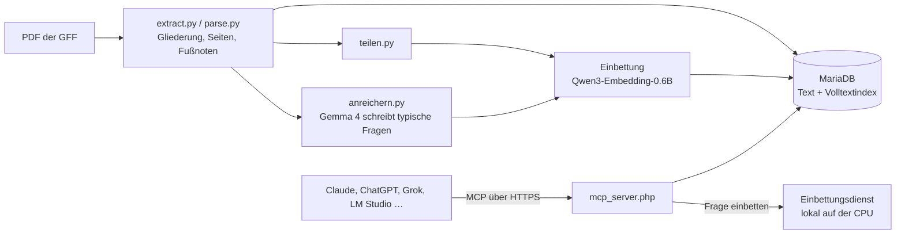

# Rede mit dem AfD-Gutachten

Eine MCP-Schnittstelle zum Rechtsgutachten **„Ist die Alternative für Deutschland verfassungswidrig?“** der Gesellschaft für Freiheitsrechte e.V. (GFF) vom 25. Juni 2026. Über sie lassen sich KI-Assistenten wie Claude, ChatGPT, Grok oder lokale Modelle in LM Studio mit dem Gutachten verbinden. Sie beantworten Fragen dann aus dem Volltext, mit Seitenzahl, Gliederungsnummer und Link auf die passende Seite der PDF.

- **Projektseite:** <https://poc.deutschkaemer.info/afd-gutachten/>
- **Connector-Adresse:** `https://poc.deutschkaemer.info/afd-gutachten/mcp`
- **Gutachten (PDF der GFF):** <https://freiheitsrechte.org/uploads/publications/Demokratie/GFF_AfD-Gutachten.pdf>

Das Projekt ist ein Proof of Concept auf [poc.deutschkaemer.info](https://poc.deutschkaemer.info/). Es ist inoffiziell und nicht mit der GFF abgestimmt, maßgeblich ist die PDF der GFF.

## Was die Schnittstelle kann

Das Gutachten umfasst rund 1.580 Seiten Text und 1.480 Seiten Anhang mit Belegen. Daraus hat die Aufbereitung 2.455 Abschnitte, 15.179 Absätze und 7.468 Fußnoten gewonnen. Knapp die Hälfte der Fußnoten verlinkt auf den Beleg in der AfD-Datenbank von FragDenStaat.

| Werkzeug | Zweck |
|---|---|
| `ueberblick` | Fragestellung, Aufbau, wo Zusammenfassung und Ergebnis stehen |
| `inhaltsverzeichnis` | Gliederung mit Seitenangaben, beliebig tief |
| `bedeutung_suchen` | Suche nach Bedeutung: Frage in eigenen Worten |
| `suchen` | Volltextsuche in Text, Belegzitaten und Fußnoten |
| `abschnitt_lesen` | einen Abschnitt im Zusammenhang lesen, mit Fußnoten |
| `seite_lesen` | eine gedruckte Seite samt Fußnoten |
| `fussnote` | Fußnoten mit Links und Beleg bei FragDenStaat |
| `rechtsgrundlage` | Wortlaut von Art. 21 GG (Gesetzestext, nicht Teil des Gutachtens) |
| `herausgeberin` | Angaben zur GFF und zur Entstehung des Gutachtens |
| `search`, `fetch` | vereinfachte Suche für Clients, die nur diese beiden Werkzeuge kennen |

Die Schnittstelle gibt dem Modell Regeln für die Antwort mit: Es soll nur wiedergeben, was das Gutachten feststellt, Belegzitate als solche kennzeichnen und keine eigene Wertung der Partei hinzufügen. Einzelheiten stehen in [docs/werkzeuge.md](docs/werkzeuge.md).

## Wie es funktioniert



1. **Aufbereitung:** Die PDF wird einmal ausgelesen. Das Layout liefert Seitenzahlen, Überschriften, Fußnoten und Belegzitate. Das Ergebnis geht als Tabellen in MariaDB ([docs/aufbereitung.md](docs/aufbereitung.md)).
2. **Vektoren:** Jeder Absatz wird mit Qwen3-Embedding-0.6B eingebettet. Zusätzlich hat ein lokales Sprachmodell zu jedem Absatz drei bis fünf Fragen geschrieben, die er beantwortet. Insgesamt sind das 45.775 Fragen, und auch sie werden eingebettet.
3. **Suche:** `bedeutung_suchen` vergleicht die Frage der Nutzerin oder des Nutzers mit den erzeugten Fragen, mit dem Originaltext und mit dem Volltextindex. Die drei Ranglisten werden zusammengeführt. Gegenüber der reinen Vektorsuche landet die passende Stelle bei den Testfragen deutlich öfter auf Platz 1 ([docs/suche.md](docs/suche.md)).
4. **Schnittstelle:** `mcp_server.php` spricht MCP über Streamable HTTP (Protokoll 2025-11-25, 2025-06-18 und 2025-03-26). Ein Konto ist nicht nötig, und es wird nur lesend zugegriffen.

## Verzeichnisse

| Verzeichnis | Inhalt |
|---|---|
| [`aufbereitung/`](aufbereitung) | PDF auslesen, gliedern, in Teile zerlegen, einbetten, mit Fragen anreichern |
| [`server/lib/`](server/lib) | MCP-Server, Datenbankzugang, Importskripte, Tabellenschema, Zusatzdaten (Art. 21 GG, Angaben zur GFF) |
| [`server/web/`](server/web) | öffentlicher Teil: Einstieg `mcp.php`, Umleitung, Zeichen und Favicons |
| [`seite/`](seite) | Projektseite: Vorlage, Bauskript, CSS, JavaScript, Logos |
| [`messung/`](messung) | Testsatz mit 46 Fragen und Skripte für die Suchmessungen |
| [`docs/`](docs) | ausführliche Dokumentation |

## Dokumentation

- [docs/aufbereitung.md](docs/aufbereitung.md): von der PDF zu den Tabellen, Teile, Einbettung, Anreicherung mit Fragen
- [docs/suche.md](docs/suche.md): Verfahren der Bedeutungssuche, Messungen, warum exakt und warum (noch) ohne Reranker
- [docs/server.md](docs/server.md): Voraussetzungen, Verzeichnisse, Datenbank, Einbettungsdienst, Betrieb
- [docs/werkzeuge.md](docs/werkzeuge.md): Protokoll, Werkzeuge, Anweisungen an das Modell, Einbindung in Clients
- [docs/projektseite.md](docs/projektseite.md): Aufbau und Gestaltung der Projektseite, Zeichen

## Selbst betreiben

Kurzfassung, ausführlich in [docs/server.md](docs/server.md):

```bash
# 1. Daten aus der PDF gewinnen (Python 3.11+, PyMuPDF)
mkdir -p arbeit/src arbeit/out && cd arbeit && curl -o src/gutachten.pdf https://freiheitsrechte.org/uploads/publications/Demokratie/GFF_AfD-Gutachten.pdf
python3 ../aufbereitung/extract.py && python3 ../aufbereitung/parse.py
python3 ../aufbereitung/teilen.py --daten out

# 2. Einbetten (llama-server mit Qwen3-Embedding-0.6B auf Port 1240)
python3 ../aufbereitung/einbetten.py

# 3. Auf dem Server: Tabellen anlegen und Daten laden (PHP 8.1+, MariaDB 11.7+)
php ~/poc/afd/import.php ~/poc/afd/daten
php ~/poc/afd/import_vektoren.php ~/poc/afd/daten/vektoren.jsonl
php ~/poc/afd/import_normen.php
php ~/poc/afd/import_herausgeberin.php
```

Ohne die Anreicherung mit Fragen funktioniert die Suche ebenfalls, nur weniger treffsicher. Den Ablauf dafür beschreibt [docs/aufbereitung.md](docs/aufbereitung.md#5-anreicherung-mit-fragen).

## Lizenzen

- **Programmcode:** MIT-Lizenz, siehe [LICENSE](LICENSE).
- **Gutachten:** © Gesellschaft für Freiheitsrechte e.V., Lizenz [CC BY 4.0](https://creativecommons.org/licenses/by/4.0/deed.de). Das Repository enthält weder die PDF noch die daraus gewonnenen Daten, beides entsteht mit den Skripten.
- **`server/lib/herausgeberin.json`:** Die Angaben aus dem Gutachten stehen unter CC BY 4.0 (GFF). Die Selbstdarstellung der GFF auf freiheitsrechte.org ist in eigenen Worten zusammengefasst, Originaltexte sind nicht übernommen. Die Zusammenfassung des Wikipedia-Artikels steht unter CC BY-SA 4.0.
- **`server/lib/normen.json`:** Art. 21 GG ist ein amtliches Werk (§ 5 UrhG).
- **Logos unter `seite/logos/`:** Marken der jeweiligen Anbieter (Anthropic, OpenAI, xAI, LM Studio). Sie dienen nur zur Kennzeichnung der Einrichtungsanleitungen.

## Einordnung

Das Gutachten ist die rechtliche Bewertung einer zivilgesellschaftlichen Organisation und keine gerichtliche Entscheidung. Die GFF weist selbst darauf hin, dass es weder vollständig noch abschließend ist. Die Schnittstelle macht es durchsuchbar und zitierbar, bewertet aber weder die Partei noch die GFF.

Fehler oder Hinweise bitte per E-Mail an dennis@deutschkaemer.info oder als [Issue](../../issues).
