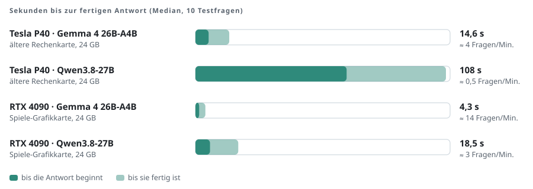

# Ausblick: Chat direkt auf der Projektseite

Bisher braucht man einen eigenen KI-Assistenten (Claude, ChatGPT, Grok, LM Studio …), um mit dem Gutachten zu sprechen. Mit einer Chat-Oberfläche auf der Projektseite ginge das auch ohne Konto und ohne Einrichtung. Die MCP-Schnittstelle bliebe dafür unverändert. Hinzu kämen ein Sprachmodell, das sie benutzt, und eine Oberfläche dafür.

Dieses Dokument beschreibt zwei Wege. **Umgesetzt ist keiner davon.**

## Fall 1: über einen KI-Anbieter, etwa Claude

```
Browser ──► Chat-Endpunkt (PHP, poc.deutschkaemer.info) ──► Claude API ◄──► MCP-Schnittstelle
   ◄──────────── Antwort als Stream (Server-Sent Events) ◄──────┘
```

Ein Endpunkt auf dem Webserver nimmt die Frage entgegen. Er ruft die [Messages API](https://platform.claude.com/docs) mit dem MCP-Connector auf, sodass das Modell die Werkzeuge dieser Schnittstelle selbst benutzen kann. Die Werkzeugaufrufe kommen dabei von den Servern des Anbieters. Die Antwort wird als Stream an den Browser weitergereicht.

```json
{
  "model": "claude-sonnet-5-5",
  "max_tokens": 2000,
  "stream": true,
  "system": "Beantworte Fragen ausschließlich mit den Werkzeugen des AfD-Gutachtens …",
  "mcp_servers": [{ "type": "url", "name": "afd-gutachten", "url": "https://poc.deutschkaemer.info/afd-gutachten/mcp" }],
  "tools": [{ "type": "mcp_toolset", "mcp_server_name": "afd-gutachten" }],
  "messages": [{ "role": "user", "content": "…" }]
}
```

Dazu wird die Beta-Kopfzeile `anthropic-beta: mcp-client-2025-11-20` mitgeschickt. Feldnamen und Beta-Kennungen legt der Anbieter fest, maßgeblich ist seine Dokumentation.

**Was nötig wäre**

- API-Konto bei Anthropic. Der Schlüssel liegt nur auf dem Server, etwa in `~/poc/config.php`, nie im Browser. Ein Ausgabenlimit in der Console begrenzt die Kosten.
- Ein Chat-Endpunkt mit Anfragegrenzen, Längenbegrenzung der Frage und Weiterleitung des Streams.
- Datenschutz: Die Fragen gehen an Anthropic in die USA. Nötig sind ein Vertrag zur Auftragsverarbeitung und ein Hinweis in der Datenschutzerklärung.

**Kostenschätzung**

Eine typische Frage braucht zwei bis vier Werkzeugaufrufe. Bei jedem Schritt wird der bisherige Verlauf erneut als Eingabe berechnet:

| Schritt | Eingabe (Token, gerundet) |
|---|---:|
| Anweisungen, Werkzeugliste, Frage | 4.000 |
| nach `bedeutung_suchen` (≈ 2.500 Token Ergebnis) | 6.500 |
| nach `abschnitt_lesen` (≈ 8.000 Token Ergebnis) | 14.500 |
| **zusammen** | **≈ 25.000** |

Dazu kommen rund 1.000 Token Ausgabe. Die Listenpreise je Million Token stehen in US-Dollar (Stand November 2026). Umgerechnet ist mit rund 1,10 US-Dollar je Euro (EZB-Referenzkurs Mitte November 2026: 1,0989):

| Modell | Eingabe | Ausgabe | je Frage | 1.000 Fragen |
|---|---:|---:|---:|---:|
| Claude Haiku 5.5 | 0,10 US-$ | 0,50 US-$ | ≈ 0,3 Cent | ≈ 3 € |
| Claude Sonnet 5.5 | 2 US-$ | 10 US-$ | ≈ 5,5 Cent | ≈ 55 € |
| Claude Opus 5.5 | 4 US-$ | 20 US-$ | ≈ 11 Cent | ≈ 110 € |

Mit Prompt-Caching für Anweisungen und Werkzeugliste sinken die Eingabekosten weiter. Lange Abschnitte erhöhen sie. Quelle der Preise: [Claude-Preisliste](https://platform.claude.com/docs/en/about-claude/pricing).

## Fall 2: eigene Hardware mit eigenen Modellen

```
Browser ──► Chat-Endpunkt (PHP) ══ SSH-Tunnel / WireGuard ══► Vermittler ◄──► llama-server (Grafikkarte)
                                                                  │
                                                                  └──► MCP-Schnittstelle
```

Der Modellserver (llama-server, LM Studio) liefert Werkzeugaufrufe nur als Vorschlag zurück und führt sie nicht selbst aus. Diese Arbeit übernimmt ein kleiner **Vermittler**:

1. Er schickt Frage, Anweisungen und die Werkzeugliste der Schnittstelle (`tools/list`) an das Modell, über die OpenAI-artige Schnittstelle `/v1/chat/completions` mit `tools`.
2. Verlangt das Modell ein Werkzeug, ruft der Vermittler es über MCP auf (`tools/call`) und gibt das Ergebnis an das Modell zurück.
3. Das wiederholt sich, bis eine Antwort steht. Sie geht als Stream an den Browser.

**Was nötig wäre**

- Ein Rechner mit leistungsfähiger Grafikkarte, mindestens 24 GB Grafikspeicher.
- Ein Modell mit Werkzeugaufrufen und mindestens 32.000 Token Kontext, weil die Antworten der Schnittstelle lang sein können. In Frage kommen etwa Gemma 4 26B-A4B (Q4_K_M, 17 GB) oder ein Qwen3-Modell.
- Der Vermittler, als kleines Python- oder PHP-Programm.
- Eine gesicherte Verbindung vom Webserver zu diesem Rechner, etwa über einen SSH-Tunnel oder WireGuard. Der Rechner muss dauerhaft laufen.
- Eine Warteschlange: Mit 24 GB läuft eine Unterhaltung zur Zeit. Je nach Karte und Modell schafft sie etwa 3 bis 14 Fragen pro Minute (siehe [Einschätzung nach einem Testlauf](#probelauf)).

**Abwägung**

- Die Fragen verlassen den eigenen Betrieb nicht, und es fallen keine Gebühren je Frage an.
- Kleinere Modelle halten die Zitierregeln weniger sicher ein und verlieren bei langen Werkzeugantworten eher den Faden. Vor einer Freigabe sollten die Antworten mit dem [Testsatz](../messung/testsatz.json) geprüft werden, auf Fundstelle, Seitenangabe und Trennung von Beleg und Bewertung.
- Strom, Wartung und Ausfälle des eigenen Rechners sind zu bedenken.

<a id="probelauf"></a>
## Lokale Hardware: Einschätzung nach einem Testlauf

Für Fall 2 gab es am 21. November 2026 einen Testlauf auf lokaler Hardware mit [`messung/chat_probe.py`](../messung/chat_probe.py). Das Skript ist zugleich ein einfacher Vermittler. Getestet wurden zwei Grafikkarten mit je 24 GB und zwei frei verfügbare Modelle mit denselben 10 Fragen aus dem Testsatz. Jede Frage lief als echter Chat: Das Modell rief die Werkzeuge der Schnittstelle selbst auf und antwortete mit Seitenangaben.

Die Bedingungen waren für alle vier Läufe gleich:
- Modell vollständig im Grafikspeicher, gestartet mit `-ngl 99 -fit off`,
- 32.000 Token Kontext,
- eine Unterhaltung zur Zeit,
- Denkmodus aus.

<picture>
  <source media="(prefers-color-scheme: dark)" srcset="bilder/probelauf-dunkel.svg">
  
</picture>

| Karte | Modell | je Antwort (Median) | Antwort beginnt | Fragen/Min. | Werkzeugaufrufe | richtige Fundstelle | Link auf PDF |
|---|---|---:|---:|---:|---:|---:|---:|
| Tesla P40 | Gemma 4 26B-A4B | 14,6 s | 5,7 s | ≈ 4 | 1,2 | 8/10 | 1/10 |
| Tesla P40 | Qwen3.8-27B | 108 s | 65 s | ≈ 0,5 | 5,1 | 8/10 | 9/10 |
| RTX 4090 | Gemma 4 26B-A4B | 4,3 s | 1,6 s | ≈ 14 | 1,3 | 8/10 | 0/10 |
| RTX 4090 | Qwen3.8-27B | 18,5 s | 6,3 s | ≈ 3 | 3,5 | 9/10 | 10/10 |

**Schnelligkeit:**

| | P40 · Gemma 4 | P40 · Qwen3.8 | 4090 · Gemma 4 | 4090 · Qwen3.8 |
|---|---:|---:|---:|---:|
| Text einlesen | 683 Token/s | 199 Token/s | 5.190 Token/s | 2.761 Token/s |
| Antwort schreiben | 52 Token/s | 13 Token/s | 160 Token/s | 47 Token/s |
| belegter Grafikspeicher | 17,3 GB | 16,8 GB | ca. 17,5 GB | ca. 17 GB |

**Was auffällt:**
- **Gemma 4 26B-A4B** ist ein Mixture-of-Experts-Modell: Je Wort rechnet nur ein kleiner Teil seiner Parameter. Es ist deshalb schon auf der Tesla P40 flott. Es sucht meist nur einmal und antwortet dann direkt aus den Fundstellen, knapp und sauber gegliedert, setzt aber kaum Links auf die PDF-Seite. Mit einer klareren Anweisung ließe sich das vermutlich beheben. Einmal verwies es auf eine falsche Gliederungsnummer.
- **Qwen3.8-27B** rechnet je Wort alle Parameter. Es recherchiert gründlicher, liest Abschnitte nach, zitiert mehr im Wortlaut und verlinkt fast immer. Auf der P40 ohne Tensor-Kerne ist es dafür sehr langsam. Dort brach es eine Frage nach 16 Werkzeugaufrufen ab, weil es im falschen Teil suchte. Auf der RTX 4090 beantwortete es alle 10 Fragen in unter 25 Sekunden.
- **Speicher:** Mit 24 GB passt neben dem Modell genau eine Unterhaltung mit 32.000 Token. Mehr Fragen pro Minute bedeuten also kürzere Wartezeiten in der Schlange, nicht mehr gleichzeitige Unterhaltungen.

Die Fundstelle wird automatisch geprüft: Liegt eine zitierte Seite in einem der erwarteten Abschnitte des Testsatzes? Diese Prüfung ist streng. Eine Antwort ohne Seitenzahl gilt dabei als falsch, auch wenn sie inhaltlich stimmt.


## Checkliste: was beide Wege brauchen

- [ ] **Ein Chatfenster:** Antworten erscheinen Wort für Wort, Belege führen direkt auf die Seite in der PDF, alles auch auf dem Smartphone bedienbar.
- [ ] **Schutz vor Missbrauch:** Begrenzte Zahl an Anfragen je Anschluss, Bindung an das Thema Gutachten und ein Hinweis, wenn gerade zu viel los ist.
- [ ] **Transparenz:** Offen sagen, welches Modell antwortet, was gespeichert wird und dass KI sich irren kann.
- [ ] **Rechtlicher Rahmen:** Impressum und Datenschutzerklärung passend zum gewählten Weg, beim Anbieter zusätzlich ein Vertrag zur Auftragsverarbeitung.
- [ ] **Prüfung vor dem Start:** Die Antworten mit festen Testfragen gegenprüfen: richtige Fundstelle, Seitenangabe, Belege und Bewertung sauber getrennt.
- [ ] **Betreuung im Betrieb:** Jemand behält Kosten, Auslastung und Fehlermeldungen im Blick und reagiert auf Hinweise.

Beide Wege lassen sich verbinden: eigene Hardware als Normalfall, der Anbieter als Ausweichweg bei hoher Last oder wenn der eigene Rechner nicht erreichbar ist.
