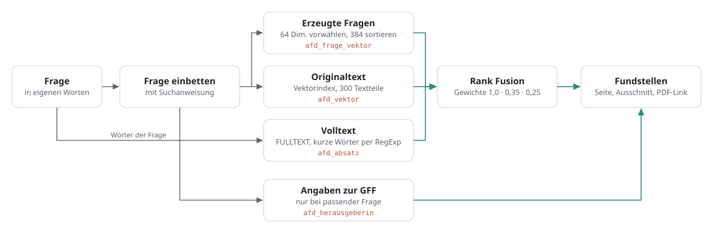

# Suche nach Bedeutung

`bedeutung_suchen` beantwortet Fragen in eigenen Worten, auch wenn das Gutachten andere Begriffe verwendet. Dieses Dokument beschreibt das Verfahren und die Messungen, auf denen es beruht. Der Code steht in `afd_w_bedeutung()` in [`server/lib/mcp_server.php`](../server/lib/mcp_server.php).

## Ablauf einer Anfrage

<picture>
  <source media="(prefers-color-scheme: dark)" srcset="bilder/suche-dunkel.svg">
  
</picture>

1. **Einbetten:** Die Frage erhält die Anweisung `AFD_VEK_ANWEISUNG` vorangestellt und wird eingebettet. Auf der CPU dauert das etwa 0,15 Sekunden.
2. **Erzeugte Fragen:** Zu jedem Textteil gibt es drei bis fünf vorab erzeugte Fragen, zusammen 45.775 (siehe [aufbereitung.md](aufbereitung.md#5-anreicherung-mit-fragen)). Die Suche läuft exakt und in zwei Stufen:
   - Vorauswahl der 400 nächsten Fragen über die auf **64 Dimensionen** gekürzten Vektoren (Tabelle `afd_frage_kurz`),
   - genaue Sortierung dieser 400 mit den vollen **384 Dimensionen** (`afd_frage_vektor`).
3. **Originaltext:** Die 300 nächsten Textteile kommen über den Vektorindex von `afd_vektor`.
4. **Volltext:** Die Wörter der Frage ohne Füllwörter laufen durch den FULLTEXT-Index im Natural-Language-Modus, sodass seltene Wörter mehr zählen. Wörter unter drei Zeichen wie „KI“ liegen unter der Mindestlänge des Index und werden per regulärem Ausdruck gesucht. So greifen auch Abkürzungen und Fachbegriffe (fdGO, Art. 21).
5. **Zusammenführen:** Die drei Ranglisten werden mit Reciprocal Rank Fusion verknüpft (Punktzahl je Liste: `Gewicht / (60 + Rang)`). Die Gewichte stehen in den Konstanten `AFD_GEWICHT_FRAGEN` (1,0), `AFD_GEWICHT_TEXT` (0,35) und `AFD_GEWICHT_VOLLTEXT` (0,25).
6. **Ausschnitt:** Ausschnitt und angezeigte Nähe kommen immer aus dem Originaltext. Kam ein Treffer über eine erzeugte Frage, wird der Teil des Absatzes gezeigt, zu dem die Frage gehört.
7. **Angaben zur GFF:** Fragen wie „Wer hat das Gutachten bezahlt?“ zielen auf die Herausgeberin, nicht auf den Inhalt. Die Einträge aus `herausgeberin.json` werden nur beigefügt, wenn eine ihrer Fragen mindestens die Nähe 0,85 erreicht und höchstens 0,005 hinter der besten Gutachten-Frage liegt. Über den Eintragstext selbst reicht eine Nähe von 0,75. Ohne diese relative Schwelle tauchten sie auch bei inhaltlichen Fragen auf, etwa „Zu welchem Ergebnis kommt das Gutachten?“.

Ist kein Einbettungsdienst erreichbar, sucht `bedeutung_suchen` ersatzweise im Volltext nach einzelnen Wörtern der Frage und sagt das in der Antwort.

## Messung

Grundlage ist der Testsatz [`messung/testsatz.json`](../messung/testsatz.json) mit 46 Fragen in Alltagssprache. Zu jeder Frage sind die Abschnitte angegeben, in denen die Antwort steht:

- `z`: Fundstellen im Hauptteil,
- `zf`: zusätzlich passende Nummern der Zusammenfassung.

Gemessen wird, wie oft eine richtige Fundstelle auf Platz 1, unter den ersten 5 und unter den ersten 10 Treffern liegt. Dazu kommt der Mittelwert des Kehrwerts des ersten richtigen Rangs (MRR@10). „Streng“ zählt nur Fundstellen im Hauptteil, „mild“ auch die Zusammenfassung.

Messungen vom 20. November 2026 (streng, 46 Fragen):

| Variante | Platz 1 | Top 5 | Top 10 | MRR@10 |
|---|---:|---:|---:|---:|
| vorher live: Vektoren des Originaltexts + Volltext | 16 | 34 | 36 | 0,49 |
| nur Vektoren des Originaltexts | 14 | 33 | 35 | 0,47 |
| nur Vektoren der Anreicherung (Fragen + Stichwörter als ein Text) | 21 | 41 | 42 | 0,62 |
| Original und Anreicherung als ein Text eingebettet | 21 | 37 | 40 | 0,61 |
| **erzeugte Fragen einzeln, Frage gegen Frage** | **26** | **39** | **44** | **0,69** |
| … mit Reranker, 20 Kandidaten | 29 | 43 | 44 | 0,75 |
| … mit Reranker, 40 Kandidaten | 32 | 41 | 44 | 0,78 |
| **jetzt live:** Fragen + Originaltext + Volltext, Haupt- und Anhang | **25** | **42** | **44** | **0,68** |

Mild gemessen erreicht die Live-Fassung 30 / 45 / 46 bei einem MRR von 0,80. Nur bei 2 der 46 Fragen ist keine richtige Fundstelle unter den ersten 10, und im milden Maß bei keiner.

### Warum die Fragen so viel bringen

Ein Absatz und eine Frage zu ihm sind verschiedene Textsorten. Das Modell bildet sie trotz Anweisung in unterschiedliche Bereiche ab. Zwei Fragen mit gleicher Bedeutung liegen dagegen dicht beieinander, auch wenn die Wörter wechseln: „Wurde KI benutzt?“ und „Hat die GFF künstliche Intelligenz eingesetzt?“. Entscheidend war, die erzeugten Fragen **mit derselben Anweisung** einzubetten wie die Suchanfrage. Ohne Anweisung lag selbst ein wörtlich gleicher Text nur bei einer Nähe von 0,49.

### Warum exakt statt Vektorindex

Für die Fragen-Vektoren verfehlte der HNSW-Vektorindex von MariaDB bei 4 der 46 Testfragen den besten Treffer, auch mit `M=48`. Die erzeugten Fragen ähneln sich sehr, und in solchen Häufungen findet der genäherte Graph den nächsten Nachbarn nicht immer. Die exakte Suche über alle Vektoren ist zuverlässig, mit 384 Dimensionen aber zu langsam.

Die Lösung nutzt die Matryoshka-Darstellung des Modells. Die ersten 64 Dimensionen tragen schon den Großteil der Bedeutung. Eine exakte Vorauswahl über 64 Dimensionen dauert bei 18.000 Fragen etwa 140 ms. Danach werden 400 Kandidaten mit 384 Dimensionen sortiert. Das Ergebnis gleicht dem der vollen exakten Suche. Die ganze Anfrage über alle 45.775 Fragen dauert von außen gemessen 0,5–0,9 Sekunden, einschließlich Netzweg und Einbettung.

Die Skripte dazu: [`messung/index_test.php`](../messung/index_test.php), [`index_m.php`](../messung/index_m.php), [`kurz_test.php`](../messung/kurz_test.php), [`exakt_zeit.php`](../messung/exakt_zeit.php).

### Warum (noch) kein Reranker

Ein Reranker ([Qwen3-Reranker-0.6B](https://huggingface.co/Qwen/Qwen3-Reranker-0.6B)) bewertet jede Frage-Kandidat-Kombination einzeln neu. Das hebt Platz 1 von 26 auf bis zu 32 Treffer. Es kostet aber Zeit:

| Reranker | 20 Kandidaten à 1.000 Zeichen |
|---|---|
| CPU (6 Kerne, sonst unbelastet) | ≈ 2,3 s je Frage |
| CPU unter Last | bis 19 s je Frage |
| Tesla P40 | ≈ 0,7 s je Frage |

Die Grafikkarte soll für andere Aufgaben frei bleiben, und auf der CPU verdreifacht der Reranker die Antwortzeit. Er ist deshalb nicht eingeschaltet. Denkbar wäre er als Option für besonders genaue Suchen.

## Selbst messen

```bash
cd arbeit
python3 ../messung/messen.py --varianten live              # gegen die Live-Schnittstelle
python3 ../messung/messen.py --varianten vek,fq,vek\|fq    # lokal aus den Vektordateien, Fusion mit |
python3 ../messung/messen.py --varianten fq+rr --rerank http://127.0.0.1:1241 --rr_n 20
python3 ../messung/pruefe_frage.py "Wurde bei dem Gutachten KI benutzt?"
```

`messen.py` schreibt die Einzelergebnisse als JSON. `unterschiede.py` vergleicht zwei Varianten Frage für Frage.
